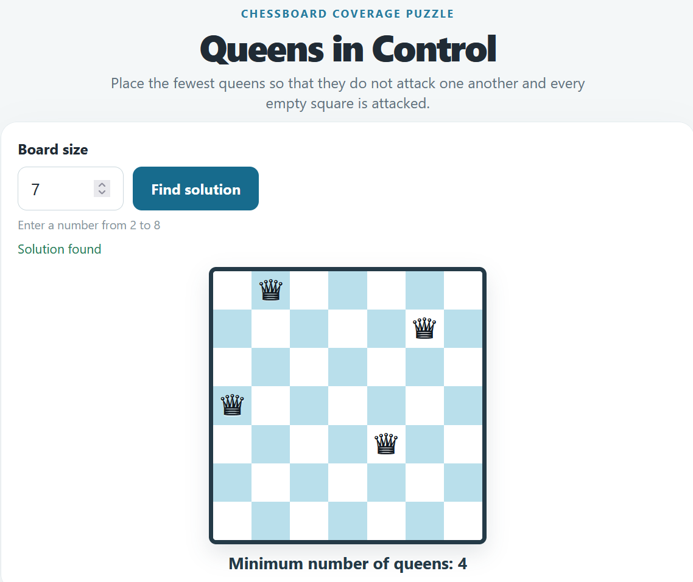

# Queen Domination on a Chessboard

[](https://github.com/ryhor-kolb-by/chess-queens/actions/workflows/test.yml)

An educational Node.js web app that finds a minimum-size placement of queens covering every empty square on a chessboard and displays the result in a browser.



Live demo: `<replace with your Vercel deployment URL>`

## How this project was built

This project was built with [Claude Code](https://claude.com/claude-code), from a
written specification through to a deployable app:

1. **Spec first.** [`TASK_SPEC.md`](TASK_SPEC.md) was written before any code — the
   board size range, the attack/coverage rules, and the acceptance criteria that the
   implementation and tests are checked against.
2. **Solver as an isolated core.** [`server/queenSolver.js`](server/queenSolver.js)
   contains only the search algorithm, with no HTTP or I/O concerns, so it can be
   tested and reasoned about on its own.
3. **Minimality checked independently.** [`test/queenSolver.test.js`](test/queenSolver.test.js)
   doesn't just check that a placement is valid — for small boards it searches for a
   smaller valid placement using a separate brute-force search, to catch cases where
   the solver returns a correct but non-minimal answer.
4. **A second adapter added later, without touching the core.** The app originally
   ran only as a local Node.js server. Deploying to Vercel (commit `f05445e`) meant
   adding `api/solve.js` as a serverless function and extracting the shared request
   validation into [`server/solveRequest.js`](server/solveRequest.js), so the local
   server and the serverless function share identical behavior instead of
   duplicating validation logic.

See [`CLAUDE.md`](CLAUDE.md) for the conventions an agent (or any contributor)
should follow when working in this codebase.

## Rules

- The board size must be an integer from **2 to 8**, inclusive.
- A queen attacks along its row, column, and diagonals.
- Queens must not attack one another.
- Every empty square must be attacked by at least one queen.
- Squares occupied by queens do not need to be covered by another queen.
- The app displays one placement using the minimum number of queens.

## Requirements

- Node.js 20 or later.

## Run

From the project root, run:

```bash
npm run dev
```

Then open [http://localhost:8090](http://localhost:8090) in a browser. The local Node.js server serves both the web UI and the API.

To start the local server directly, run:

```bash
npm start
```

## Deploy to Vercel

The project is arranged for Vercel deployment:

- `public/` contains the static web interface.
- `api/solve.js` handles `POST /api/solve` as a serverless function.
- `server/queenSolver.js` contains the solver shared by the local server and Vercel function.

Import the repository into Vercel and deploy it from the repository root. No frontend build command or third-party runtime dependencies are required. The local `npm run dev` command continues to start the standalone Node.js server for development.

## API

### `POST /api/solve`

Request body:

```json
{"size": 8}
```

Example successful response:

```json
{
  "size": 8,
  "queens": [
    {"row": 0, "column": 0},
    {"row": 1, "column": 2},
    {"row": 2, "column": 4},
    {"row": 3, "column": 1},
    {"row": 4, "column": 3}
  ]
}
```

Coordinates are zero-based. Invalid JSON or a size outside 2–8 returns an error response with an `error` field.

## Tests

Run the automated tests with:

```bash
npm test
```

Tests cover placement validity and minimality on small boards, the 8×8 board, API validation, and serving the HTML, CSS, and JavaScript assets. GitHub Actions runs them on Node.js 20, 22, and 24 for every push to `main` and every pull request.

## Project structure

```text
api/
  solve.js             Vercel serverless API function
server/
  index.js             local HTTP server
  queenSolver.js       minimum queen placement solver
  solveRequest.js      shared API validation and solver call
public/
  index.html           page markup served as a static asset
  src/main.js          input handling, API request, and board rendering
  src/style.css        styles
test/
  api.test.js          local server and Vercel API tests
  queenSolver.test.js  solver tests
CLAUDE.md               conventions for agents/contributors working in this repo
TASK_SPEC.md           full project specification
```

See [TASK_SPEC.md](TASK_SPEC.md) for detailed requirements and acceptance criteria.
